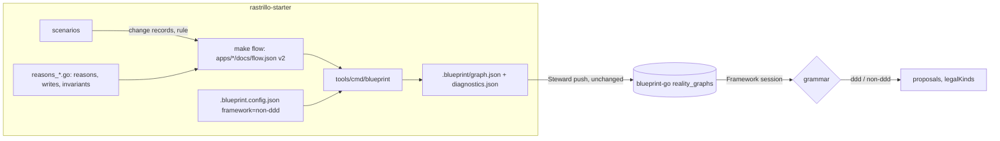

# RS-20: a Blueprint graph for rastrillo apps, and the non-ddd framework in blueprint-go

Mode: attended. Two repositories: rastrillo-starter (`feat/blueprint-graph`, cut from `master` at 4b28687) and blueprint-go (worktree `../blueprint-go-non-ddd`, `feat/non-ddd-framework`, cut from `master` at a8d3525). Grounding degraded: there is no `CONTEXT.md` for the extraction itself; the glossaries read are the app's `CONTEXT-accounts.md` and `CONTEXT-notes.md`, and ADR 0003 (*the flow chain is extracted, not enforced*) governs the map.

## Problem

A rastrillo repository already knows what its code does: every scenario lands change records, and `make flow` reads them into `apps/<app>/docs/flow.md` and `flow.json`. But Blueprint cannot draw any of it:

- `flow.json` has its own shape, not Blueprint's `graph.json`.
- Nothing writes `.blueprint/`, so Steward has nothing to push.
- blueprint-go enforces the DDD eventstorming grammar (commands handled by aggregates or systems, policies issuing commands). A rastrillo app has neither aggregates nor systems: a context lands its own fact in reaction to another's (`MemberJoined[accounts] ⟹ WelcomeNoteWritten[notes]`). Squeezing that into DDD needs invented boxes, as pv4's RUS-84 (*gastos-rs describe*) had to: a `system` per context, a derived `Cross{From}To{To}` command per crossing, and a new Blueprint triple for agents.
- The starter declares no invariant, so the rule a write obeyed and the rule a refusal enforced are on no record and in no graph.

## Solution

From the owner's side:

1. **Invariants are named, in pv4's RUS-83 shape.** Each context declares its rules beside its reasons. A write a rule shaped carries the rule on its change record. A refusal names its rule, lands nothing, logs one line and marks the screen with `data-rule`.
2. **`make blueprint` writes `.blueprint/graph.json` and `.blueprint/diagnostics.json`** at the repository root. It reads every app's committed `flow.json`, now at version 2 and carrying the rules, invariants, tables and sources the graph needs. The graph has the structure **command → invariant → [context] event → policy (only across contexts) → [other context] event**.
3. **`.blueprint.config.json` (committed) says `framework: "non-ddd"`** and names `make blueprint` as `designTooling.extract`. The extractor stamps `framework` into `graph.json`, so Steward pushes it unchanged.
4. **blueprint-go reads the framework off the session's latest reality graph** and validates design proposals, and serves `legalKinds`, under that framework's grammar. A graph with no `framework`, or a session with no push yet, stays `ddd`, so pv3 repositories see no change.

## User Stories

1. As an app author, I declare an invariant once beside my reasons, and both the change records and the Blueprint board show it.
2. As an app author, a write my rule shaped without naming it is refused before SQLite, naming the rule and the fix.
3. As a member, when a rule refuses me I see what went wrong in plain words. The rule's name stays in the markup, not in the text.
4. As on-call, I find one log line per refusal (rule, context, entry point, actor, trace id) by `X-Correlation-Id`.
5. As a `/changes` reader, I see which rule shaped a change.
6. As a scenario author, I assert a refusal by its rule's name through the real entry point.
7. As a designer, I open a Blueprint session on a rastrillo repository and see its commands, invariants, events, cross-context policies, agents and tables, grouped by context, without boxes the code doesn't have.
8. As the design agent, I propose `policy produces event` on a non-ddd board and it is accepted. The same proposal on a pv3 board is refused as before.
9. As a maintainer, `make ci` fails when the extractor emits an edge the non-ddd grammar refuses, or when two apps claim one context. Everything else the graph finds is reported, never failed (ADR 0003).

## Resolved decision tree

<!-- map-tree:v1 ticket=RS-20 gen=2 src=sha256:9d32ae984811dfe8f278463045617f1d6d6e0af55d748cf424cd62664d764018 out=sha256:8a886a461f6c162320d7290eef9185cb4dd6c422213be35e958b8fc691932e4f -->
`map-tree:v1 ticket=RS-20 gen=2 src=sha256:9d32ae984811dfe8f278463045617f1d6d6e0af55d748cf424cd62664d764018 out=sha256:8a886a461f6c162320d7290eef9185cb4dd6c422213be35e958b8fc691932e4f`
### RS-20-F1 — Extraction source: run the scenarios at extract time, or build from the committed flow.json: Build from committed apps/*/docs/flow.json v2 with a root tool

decided(owner)

Why: flow.json is already the drift-checked map a Blueprint board renders from (AGENTS.md); extraction stays cheap and matches the pushed commit.

resolved_by: human

- Rejected — Run every app's scenarios at extract time: no reason recorded

### RS-20-F2 — Monorepo merge: one graph per repository against several apps: Merge every app; subdomain = context; a clash is a nameCollisions entry

decided(owner)

Why: A context name is the business's word, unique across apps that talk over HTTP.

resolved_by: human

- Rejected — Merge; subdomain = <app>-<context>: no reason recorded
- Rejected — One graph per app (Steward change): no reason recorded

### RS-20-F3 — Mixed-context entry point: which subdomain its command node gets: One command node per (entry point, context), plus a mixedContextRequests diagnostic

decided(owner)

Why: It mirrors flow.json's per-context entry_points and draws the smell instead of hiding it.

resolved_by: human

- Rejected — One node in the context with most facts: no reason recorded
- Rejected — A synthetic mixed subdomain: no reason recorded

### RS-20-F4 — Policy node label: {From}Then{To} in the target context

decided(owner)

Why: No code change; option 2 can replace it later (renaming ids).

resolved_by: human

- Rejected — Declared policy names beside the reasons, held by a binding test: no reason recorded
- Rejected — A policy column on the record: no reason recorded

### RS-20-F5 — Diagnostics: which are emitted and which fail make ci: Fail on topologyViolations and nameCollisions only; report orphans and flow findings as extra keys

decided(owner)

Why: Enforces only tool defects and cross-app ambiguity; ADR 0003 stays whole.

resolved_by: human

- Rejected — Fail on nothing: no reason recorded
- Rejected — Fail on orphans too: no reason recorded

### RS-20-F6 — Non-ddd grammar extras beyond the four settled edges: Add external-system invokes command and event writes-to datastore; keep ui invokes command

decided(owner)

Why: The kept mapping already has tracked table → datastore and agent → external-system; each needs exactly one triple.

resolved_by: human

- Rejected — Only external-system invokes command: no reason recorded
- Rejected — Only the four settled edges: no reason recorded

### RS-20-F7 — Example invariants the starter ships in myapp: ACorrectionChangesSomething guards NoteCorrected (refuse) and EveryNewMemberIsWelcomed shapes WelcomeNoteWritten:[notes] (By)

decided(owner)

Why: Exercises both halves of RUS-83's shape through existing scenarios.

resolved_by: human

- Rejected — Only the guard: no reason recorded
- Rejected — None: no reason recorded

### RS-20-F8 — How framework travels from the repo to blueprint-go: Extractor stamps framework at the top of graph.json; blueprint-go reads the session's latest reality graph, default ddd

decided(owner)

Why: One source, the repository; zero Steward changes; pv3 graphs stay ddd.

resolved_by: human

- Rejected — Steward sends framework beside the graph: no reason recorded
- Rejected — A session setting set by hand: no reason recorded

### RS-20-F9 — blueprint-go scope: Go side only, or the island too: Go side only: grammar by framework, proposal validator, legalKinds by framework, instructions.txt; island deferred

decided(owner)

Why: Island work waits until the WIP lands.

resolved_by: human

- Rejected — Go side plus island now: no reason recorded

### RS-20-F10 — .blueprint/ artifacts: generated or committed: Generated and gitignored; .blueprint.config.json committed with designTooling.extract and framework non-ddd

decided(owner)

Why: flow.json is already the committed truth.

resolved_by: human

- Rejected — Committed with a drift check: no reason recorded

### RS-20-F11 — Where a shaping rule on a policy-landed event attaches: Add policy guarded-by invariant to non-ddd

decided(owner)

Why: The rule lives in the reacting context and the policy is its only writer.

resolved_by: human

- Rejected — Attach to the entry command Join: no reason recorded
- Rejected — No edge, orphan reported: no reason recorded
`/map-tree:v1`
<!-- /map-tree:v1 -->

## Implementation Decisions

### Carried from the handoff (owner-settled before this design; folded here from `.work/handoff/blueprint-graph-non-ddd.md`'s Durable region)

- **Invariants follow RUS-83's shape (owner, 2026-10-13).**
  - Each context declares its invariants beside its reasons: a name (the identifier a record and a refusal carry), a rule sentence in the business's words, `Guards []reason` and `Shapes map[reason][]table`.
  - A shaped table must be one that reason writes.
  - A change carries the nullable `rule` that shaped it. A shaped write without its rule is refused.
  - `/changes` and `/changes.json` show `rule`, omitted when null. `verify` checks it.
  - A refusal lands nothing and logs one line. The screen shows only the detail and carries the name as `data-rule` (RUS-83-F16).
  - A scenario can assert a named refusal. The flow map lists rules per reason.
- **Graph mapping (RUS-84's, kept):**

  | Code | Graph |
  |---|---|
  | entry point | `command` |
  | reason | `event` |
  | context | `subdomain` |
  | cross-context cause | `policy` |
  | `agent:<name>` actor | `external-system` |
  | tracked table | `datastore` |
  | invariant | `invariant`, with `errorCodes: [name]` and `rule` |

  Ids are Blueprint's `nodeId`, built with an exact port of `slugify`. Nodes are sorted by id and edges by from, kind, to. No timestamps, pretty JSON, trailing newline. `meta.source` is on every node.
- **non-ddd replaces RUS-84's DDD workarounds.** There is no `system` per context, no derived `Cross…To…` command, and nothing changes in Blueprint's DDD list.
- **Facts verified in grounding** (each re-checked this session):
  - Steward posts only `.blueprint/graph.json`, `diagnostics.json` and `.blueprint.overrides.json`, after running `designTooling.extract` from the target's `.blueprint.config.json` (`push`, `blueprint-steward.mjs:272-295`).
  - blueprint-go stores the graph verbatim and checks only that `graph` is an object (`read`, `reality/reality.go:211-248`).
  - Edge legality lives in one place, `IsAllowedEdge` (`design/vocabulary.go:91`). It is used by `proposed` (`design/design.go:471`), `batch.go:157` (`AllowedEdgeKinds`) and the view's `legalKinds` (`design/view.go:34`).
  - Every edge kind this design needs is already in `EdgeKinds` (`vocabulary.go:23-27`), so `comments/anchor.go:35-37` is unchanged.
  - blueprint-go already holds Go ports of `slugify`/`nodeId` (`Slugify`, `NodeKey`, `vocabulary.go:110-122`).

### Starter: `libs/changes` (the RUS-83 port)

- **`changes.Invariant{Name, Context, Rule string; Guards []string; Shapes map[string][]string}`** (reason → tables). `Policy.Invariants []Invariant` is installed beside `Allow`.
- **`(*Trail).By(rule)`** names the rule for the writes under the Trail's current `Because`; a new `Because` clears it. In the hook, after `fits`:
  - `ErrRuleMismatch`: the named rule doesn't shape this (reason, table).
  - `ErrRuleRequired`: a declared rule shapes this (reason, table) and none was named.

  Both name the reason, the table and the rule, as `ErrReasonMismatch` does.
- **`changes.rule TEXT NULL`** is migration `libs/changes/migrations/0005_changes_rule.sql`. `Change.Rule` is added, the append-only trigger is unchanged, and `/changes.json` gains `rule`, omitted when null. AGENTS.md's field-name contract gains `rule` in the same commit. `/changes` shows ` · by rule <Name>`.
- **`(*Trail).Refuse(ctx, rule, detail) *Refused`** lands nothing. It writes one `InfoContext` line `refused` with `rule`, `context`, `entry_point` and `actor`; `telemetry.Correlate` adds `trace_id`. A rule no context declares panics in tests and is an error in production: an undeclared name is a programming error, like an undeclared reason.
- **`verify`** checks every record whose rule no declared invariant has (any age), and every shaped (reason, table) record without a rule, **but only for records created after `0005_changes_rule`'s ledger `applied_at`**. This ports pv4's RUS-83 D11 (*a record from before the rule column is not held to name one*). Without that cutoff, every existing instance fails verify forever. **UNVERIFIED:** that rastrillo's migrate ledger exposes `applied_at`. Build checks this first; the fallback is the first record whose `rule` column exists.

### Starter: myapp

- **`reasons_<context>.go` gains `<context>Invariants`**, gathered as `Invariants` in `reasons.go`. `CONTEXT-<context>.md` gains each name in the same commit.
  - notes: `ACorrectionChangesSomething`, *"A correction must change the note's title or its body."*, guards `NoteCorrected`.
  - notes: `EveryNewMemberIsWelcomed`, *"Every member who joins gets a welcome note."*, shapes `WelcomeNoteWritten: [notes]`.
- **`noteCorrect`** compares the posted title and body with the note's current ones before any write. An unchanged correction is `t.Refuse(ACorrectionChangesSomething, "That correction changes nothing: edit the title or the body.")`, rendered at 422 by a refusal partial `
detail
`.
- **The welcome policy** writes with `.By(EveryNewMemberIsWelcomed)`.
- **Scenario vocabulary** (`scenario_test.go`): `refusedBy(resp, rule)`, which checks 422, `data-rule` and that no change landed; and `changed(...)` matching a rule.
- **The invariant binding test** (beside `binding_test.go`): every declared invariant appears in a scenario's Then (refused by it, or a change carrying it), and a Then naming an undeclared rule doesn't compile.
- **The oracle's vocabulary copy** gains the invariants, held to `reasons_*.go` like the reasons.

### Starter: `flow.json` v2 (`flowVersion = 2`)

- `entry_points[]` and `policies[]` gain `rules: [{reason, rule}]`, read off the records' `rule`.
- New top-level fields:
  - `app`
  - `invariants: [{name, context, rule, guards, shapes, source}]` (from `myapp.Invariants`)
  - `writes: [{reason, context, tables}]` (from `ReasonWrites`, tables only)
  - `sources: {entry_points, reasons, tables, invariants}`, each a map from name to `{file, line}`, app-root relative
- **Sources are scanned with `go/parser`:**
  - an entry point's source is the first call anywhere in the app whose string-literal argument equals its name (not tied to `a.trail`, so blueprint2's `kit` call sites match)
  - a reason's or invariant's source is its declaration in `reasons_<context>.go`
  - a table's source is its struct in `models.go`

  **A census test fails, naming it, when an entry point in the map has no source.** The scan reads files Go's test cache can't see. `flow` and `flow-check` already run as their own make targets; build confirms they pass `-count=1`.
- `flow.md` lists rules per reason. Every list stays sorted and never null.

### Starter: the graph (`tools/cmd/blueprint`, `make blueprint`)

- **A program in the `tools` module.** It reads the root `.blueprint.config.json` (`framework`) and every `apps/*/docs/flow.json`, and imports no app. A flow.json older than version 2 is refused with "run make flow in apps/<app>".
- **Nodes:**
  - `command` per (entry point, context) (fork F3)
  - `event` per reason
  - `policy` per cross-context policy, labelled `{From}Then{To}` in the target context (fork F4)
  - `invariant` per invariant, with `rule` and `errorCodes: [name]`
  - `datastore` per table a reason writes
  - `external-system` per `agent:<name>` actor

  Labels are capital case (`Write Note`), as pv3 writes them, and `meta.runtimeName` keeps the code's spelling. Ids are equal either way, since `slugify` splits both. `meta.source` and `meta.app` are on every node. A policy's source is the target reason's declaration, because records don't name the policy function.
- **Edges:**

  | Edge | Built from |
  |---|---|
  | `command produces event` | the entry's reasons |
  | `command guarded-by invariant` | the invariant guards or shapes a reason the command produces, or the entry's `rules` name it |
  | `event triggers policy` | the policy's source event |
  | `policy produces event` | the policy's target event |
  | `policy guarded-by invariant` | the hop's `rules` (fork F11) |
  | `external-system invokes command` | the agent actors on the entry |
  | `event writes-to datastore` | the reason's `writes` |
- **Ids:** `Slugify`/`NodeKey` are copied from blueprint-go's `design/vocabulary.go` along with its test cases. The copy's comment names the source file.
- **`graph.json`** = `{schemaVersion: 1, framework, subdomains, nodes, edges}`.
- **`diagnostics.json`** carries pv3's eight arrays, always present:
  - `topologyViolations` (each edge against the non-ddd grammar)
  - `nameCollisions` (a context declared by two apps, or two nodes with one id)
  - `orphanNodes`
  - the other five, empty

  Plus the flow findings as extra keys: `unnamedEntryPoints`, `emptyEntryPoints`, `mixedContextRequests`, `implicitCrossings`.
- Files are written atomically. **The program exits 1 on `topologyViolations` or `nameCollisions` only** (fork F5).
- **Root Makefile:** `blueprint` runs it. The root `make ci` gains `blueprint-check`, which runs it into a temp directory over the committed flow maps and fails on exit 1. `.gitignore` gains `.blueprint/`, and `.blueprint.config.json` is committed (fork F10). Steward reads `docsRoot` from the same file; leaving it unset keeps `docs/prs`.

### blueprint-go (Go side only; fork F9)

- **`design/vocabulary.go`:**
  - `FrameworkDDD = "ddd"`, `FrameworkNonDDD = "non-ddd"`.
  - `rules` becomes the DDD list. A second `nonDDDRules` list holds exactly the decided grammar: `command produces event`, `command guarded-by invariant`, `event triggers policy`, `policy produces event`, `policy guarded-by invariant`, `external-system invokes command`, `event writes-to datastore`, `ui invokes command`.
  - `IsAllowedEdge` and `AllowedEdgeKinds` take the framework; an unknown value is `ddd`.
  - `NodeTypes`, `EdgeKinds` and `NodeKey` are unchanged.
- **The framework comes from the session's latest reality graph** (fork F8). The reality package exports `Framework(ctx, db, session) string`, which reads the top-level `framework` of the newest `reality_graphs` row and returns `ddd` when absent. Features never import each other, so root wires it into the design feature's `Deps`.
  - `proposed`, `batch.go`'s kind choice and the view's `legalKinds` use it.
  - **Elements already on the board are never re-validated** when the framework changes; only new proposals are.
- **`steward/method/instructions.txt`** gains the non-ddd vocabulary: when the board's framework is non-ddd, propose only these edges, with no aggregates, systems or read models.
- **Contract fixture:** the myapp graph `make blueprint` emits is committed as blueprint-go testdata. A test checks every edge in it under `non-ddd` and every id against `NodeKey`. This holds the starter's grammar copy and blueprint-go's together (critique, arch 1).

## Testing Decisions

The seams, highest first, each with prior art:

1. **The app's scenarios** (`internal/myapptest`), already there. `TestScenarioCorrectingANote`'s neighbour gains *an unchanged correction is refused by `ACorrectionChangesSomething`*. `TestScenarioJoining`'s Then gains *the welcome note carries `EveryNewMemberIsWelcomed`*. The invariant binding test mirrors `binding_test.go`.
2. **The flow extraction:** `flowOf` unit tests mirror `TestFlowReportsWhatItFinds` for `rules`, `invariants`, `writes` and `sources`, plus the existing `make flow-check` drift gate over the committed v2 file.
3. **`tools/cmd/blueprint`:** a golden test from a two-context fixture `flow.json` to the expected `graph.json` and `diagnostics.json`. It covers each mapping row, a mixed entry point, a name collision across two apps (exit 1), an illegal edge (exit 1) and an orphan (exit 0). `slugify` parity runs over blueprint-go's own cases.
4. **blueprint-go:** the `design` package's vocabulary tests by framework; the contract-fixture test; and one `servertest` scenario where a session whose latest push says `non-ddd` accepts `policy produces event` and a session without one refuses it (`EdgeKindNotAllowed`).

**Tracer bullets** (nothing catches these automatically, so they come first):
- **`slugify` parity**, ported and tested first, since a divergent character class silently renames every id.
- **The `refused` line on a running myapp's stderr** (`make dev`, an unchanged correction).

**Gates:** the starter's `make ci` (summary PASS only when nothing is skipped), and blueprint-go's local gate from `~/.claude/teselly-ci.md`. GitHub Actions are off; a SKIP is not a pass.

## Risks

1. **Two copies of the non-ddd grammar** (the starter's extractor and blueprint-go's `vocabulary.go`). Mitigated by the contract fixture, but the fixture is only as fresh as its last copy. Surfaces as a blueprint-go proposal refused for an edge the extractor emits.
2. **Island after the owner's WIP lands.** The rewrite in `../blueprint-go` (`island/board/`, uncommitted) calls `blueprint-schema`'s DDD-only `allowedEdgeKinds` on the client (`coupling-choice.ts:42`, `design-writes.ts:293`). On a non-ddd board, a person drawing a connector won't be offered `policy produces event`. Reality nodes still render, since every node type already exists. Surfaces the first time someone draws on a non-ddd board.
3. **Deploy order.** A non-ddd graph pushed to an older blueprint-go is stored, and the agent's non-ddd proposals are refused. Ship blueprint-go first; rollback is a config edit.
4. **The `rule` cutoff in `verify`** depends on the migrate ledger's `applied_at` (UNVERIFIED). Surfaces as `verify` failing on a pre-existing database.
5. **The source scan** matches string literals. A literal that happens to equal an entry point's name elsewhere would point `meta.source` at the wrong line. Surfaces only on the board, as a wrong jump.
6. **Policy labels are derived** (`{From}Then{To}`). Moving to declared names later renames every policy id, and proposals keyed to the old ids go stale.

## Out of Scope

- **Island changes**, including connector legality on the client and any `blueprint-schema` change. Re-check `git -C ../blueprint-go status --short` before planning them.
- **Steward changes**, and any reality-route contract field.
- **Porting to blueprint2 and to blueprint-go's own apps** (`apps/server`, `apps/admin` carry their own `flow_test.go`). They follow by copying once this lands.
- **Declared policy names** (fork F4's option 2), and a `policy` column on the record.
- **One graph per app** (fork F2's option 3).
- **Form-validation 422s** (the title check), which stay unnamed, as in RUS-83.
- **A Blueprint judge running Blueprint's own TypeScript** (RUS-84's optional judge); the blueprint-go contract fixture replaces it.
- **Unspecified seams:**
  - a refusal after the Trail has already written in that request (RUS-83 left it open too)
  - the oracle asserting rules black-box through `/changes.json`
  - whether a framework change should ever re-validate standing elements
  - `ui` and `read-model` nodes, which the starter does not extract

## Provenance

- Handoff: `.work/handoff/blueprint-graph-non-ddd.md` (session d273410e). Its Durable region is folded above.
- pv4: `docs/prs/RUS-83/{design,decisions}.md` and `.work/multi/multi-rus-loop/units/RUS-84.ticket-block.md`, read in full this session.
- Re-run to re-derive the grounding:
  - `sed -n 1,130p ../blueprint-go-non-ddd/apps/server/internal/server/design/vocabulary.go`
  - `grep -rn "IsAllowedEdge\|AllowedEdgeKinds" ../blueprint-go-non-ddd/apps --include='*.go'`
  - `sed -n 260,300p ../blueprint-steward-go/packages/steward/bin/blueprint-steward.mjs`
  - `grep -rn "legalKinds\|blueprint-schema" ../blueprint-go-non-ddd/apps/server/island/src` (HEAD: `legalKinds` from the view only)
  - `grep -rn "allowedEdgeKinds" ../blueprint-go/apps/server/island/board` (WIP: two client-side calls)
  - `git -C ../blueprint-go status --short | wc -l` (62 at design time)
- Nothing outside each repository's own `flow_test.go` reads `flow.json`. Steward's `flush.mjs` hit was `workflow.json`.
- `RS-20` was created in Jira for this work on 2026-10-13; RS-19 was already taken.
- No build, test or gate was run in this step.
